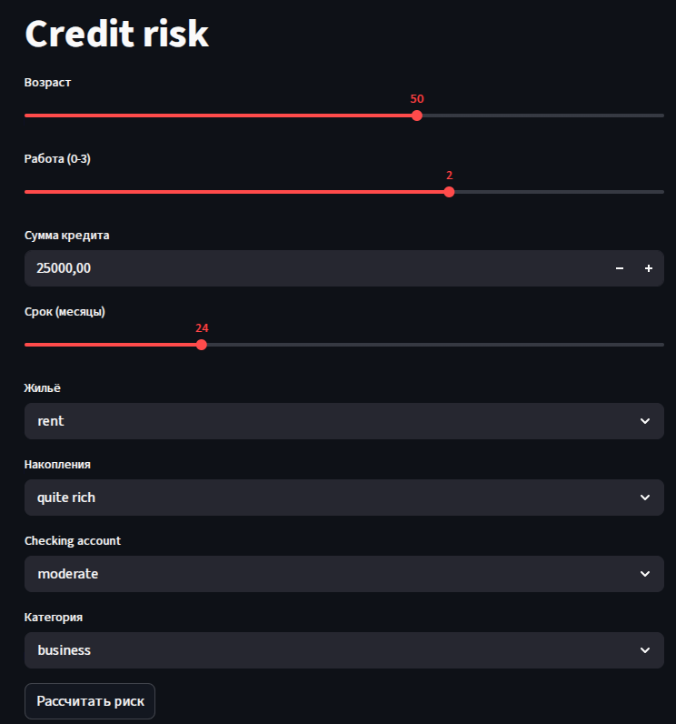
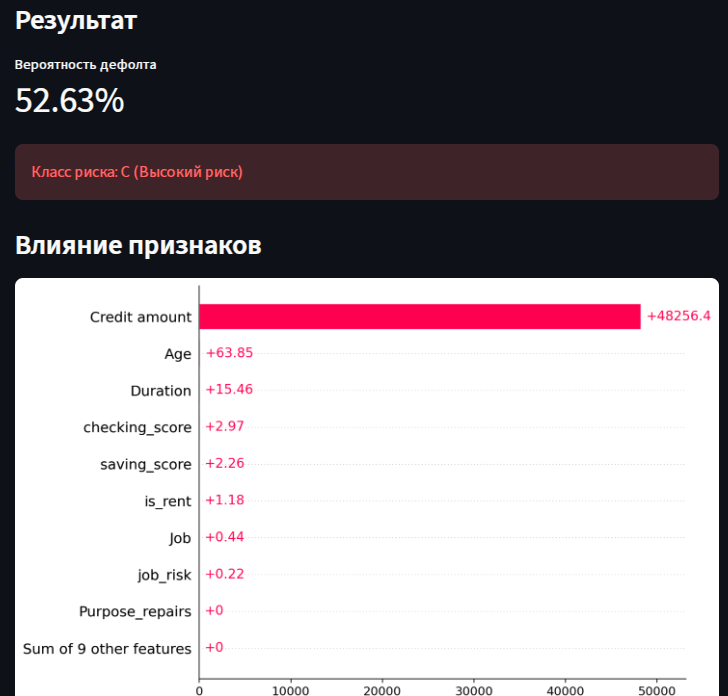

# Credit-risk — учебный кредитный скоринг

Проект показывает подготовку табличных признаков, обучение логистической регрессии и создание интерфейса на Streamlit.

**Целевая метка `Risk` искусственная:** в исходном `credit.csv` нет наблюдаемых дефолтов. Ноутбук задаёт положительный класс правилом:

```python
Risk = (
    (df["Credit amount"] > 8000)
    & (df["Duration"] > 24)
    & (df["Checking account"] == "little")
).astype(int)
```

Модель учится приближать это правило по тем же исходным признакам. Её выход нельзя интерпретировать как подтверждённую вероятность реального дефолта или использовать для кредитных решений.

## Что реализовано

- Исследование 1 000 записей, обработка пропусков и кодирование категорий.
- Признаки состояния счетов, жилья, занятости и цели кредита.
- Pipeline: `StandardScaler` → `LogisticRegression(class_weight="balanced", max_iter=5000)`.
- Разделение train/test 80/20 с `stratify=y` и `random_state=42`.
- Оценка ROC-AUC, precision, recall и F1 при пороге `p > 0.3`.
- Условные категории A/B/C, сохранение модели через joblib.
- Код Streamlit-прототипа и SHAP-визуализации внутри ноутбука.

## Структура

| Файл | Назначение |
| --- | --- |
| [Credit risk.ipynb](Credit%20risk.ipynb) | Подготовка данных, обучение, метрики, интерактивный ввод и генерация приложения |
| [credit.csv](credit.csv) | Исходные признаки; столбец Risk создаётся в ноутбуке |
| [screens/](screens/) | Скриншоты прототипа |

Файлы `app.py`, `credit_model.pkl` и `feature_columns.pkl` создаются при выполнении соответствующих ячеек; в репозитории они не сохранены. `requirements.txt` также отсутствует.

## Локальный запуск

```bash
git clone https://github.com/golovanov-andrei/Credit-risk.git
cd Credit-risk
python -m venv .venv
```

Активируйте окружение:

```powershell
# Windows PowerShell
.\.venv\Scripts\Activate.ps1
```

```bash
# macOS / Linux
source .venv/bin/activate
```

Установите библиотеки и откройте ноутбук:

```bash
python -m pip install jupyter pandas numpy scikit-learn matplotlib seaborn joblib streamlit shap
jupyter notebook "Credit risk.ipynb"
```

1. В обеих ячейках загрузки замените `pd.read_csv('/credit.csv')` на `pd.read_csv('credit.csv')`.
2. Выполните подготовку данных, обучение и оценку качества по порядку.
3. Для веб-прототипа выполните обе ячейки `joblib.dump(...)`, сохраняющие модель и список признаков, затем ячейку `%%writefile app.py`.
4. Из каталога с созданными файлами запустите:

```bash
python -m streamlit run app.py
```

Приложение откроется на [localhost:8501](http://localhost:8501). Ячейка консольного ввода ждёт ответов пользователя. Последняя ячейка с `cloudflared` предназначена для туннеля из среды ноутбука и для локального запуска не нужна.

## Сохранённые результаты

Значения взяты из вывода ноутбука; обучение при обновлении README не повторялось.

| Метрика | Значение |
| --- | ---: |
| ROC-AUC | 0.9679 |
| Precision | 0.3333 |
| Recall | 0.6667 |
| F1 | 0.4444 |

В сохранённой тестовой выборке всего **3 положительных примера из 200**, поэтому precision, recall и F1 чувствительны к единичным ошибкам. Эти метрики относятся к искусственной метке.

Категории интерфейса используют другие границы: A — `p < 0.2`, B — `0.2 ≤ p < 0.5`, C — `p ≥ 0.5`. Это демонстрационные категории, а не валидированный кредитный рейтинг.

## Прототип




## Известные ограничения

- Предобработка в интерактивном вводе и приложении отличается от обучения: `is_male` и `no_checking_account` подставляются нулями; консольный ввод также не кодирует выбранную цель кредита.
- SHAP в приложении получает исходные признаки, хотя логистическая регрессия обучена после `StandardScaler`. Для корректной интерпретации нужно согласовать преобразования и фоновую выборку.
- Версии зависимостей не зафиксированы; повторение сохранённых чисел на другом окружении не проверено.

Следующие шаги: единая предобработка для обучения и инференса, согласованная SHAP-интерпретация и отдельный эксперимент с настоящей целевой меткой.

Автор: [Андрей Голованов](https://github.com/golovanov-andrei).
