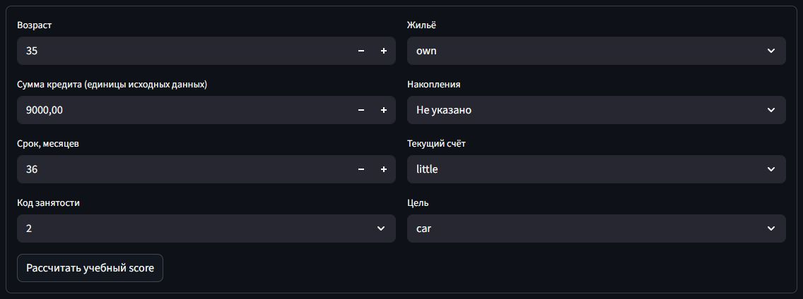
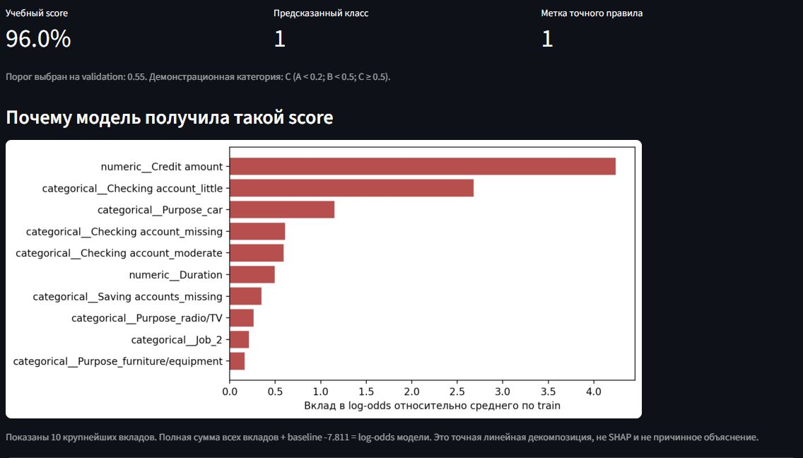

# 💳 Credit Risk — Classification & Scoring

Учебный ML-проект на данных о заёмщиках: исследование признаков, классификация несбалансированных данных и интерактивное приложение на **Streamlit**. Единый **scikit-learn Pipeline** используется для обучения, предсказания и объяснения результата.

Целевая метка создана искусственным правилом. Модель показывает score этой метки; он не является оценкой вероятности реального дефолта.

---

## 💡 Пример реализации

<table>
  <tr>
    <td width="50%"></td>
    <td width="50%"></td>
  </tr>
  <tr>
    <td align="center"><b>Параметры заёмщика</b></td>
    <td align="center"><b>Score и объяснение модели</b></td>
  </tr>
</table>

Скриншоты сделаны в работающем приложении с моделью, обученной на `credit.csv`.

---

## 🚀 Ключевые возможности

- **Единый Pipeline** — обработка пропусков, масштабирование, One-Hot Encoding и логистическая регрессия.
- **Работа с дисбалансом** — `class_weight="balanced"`, сравнение с baseline и метрики редкого класса.
- **Раздельная оценка** — train / validation / test; порог выбирается по F1 на validation.
- **Веб-приложение** — ввод параметров, расчёт score, бинарный класс и категории A / B / C.
- **Объяснение предсказания** — график вкладов признаков в log-odds и полная таблица.
- **Воспроизводимый запуск** — CLI для обучения и предсказаний, сохранение всей цепочки в одном артефакте.

---

## 🛠 Технологический стек

- **Python 3.12**
- **pandas, NumPy** — обработка данных
- **scikit-learn** — предобработка, классификация и метрики
- **Matplotlib** — визуализация вкладов
- **joblib** — сохранение Pipeline
- **Streamlit** — веб-интерфейс
- **pytest, GitHub Actions** — автоматические проверки

---

## 📈 Этапы реализации

### 1. Данные и подготовка признаков

В `credit.csv` — **1 000 записей**. Модель использует восемь признаков:

| Признак | Описание |
| --- | --- |
| `Age` | Возраст |
| `Credit amount` | Сумма кредита в единицах исходных данных |
| `Duration` | Срок в месяцах |
| `Job` | Категориальный код занятости: 0–3 |
| `Housing` | Тип жилья |
| `Saving accounts` | Категория накоплений; допускается пропуск |
| `Checking account` | Категория текущего счёта; допускается пропуск |
| `Purpose` | Цель кредита |

Числовые признаки масштабируются через `StandardScaler`. Пропуски счетов получают отдельную категорию, категориальные признаки проходят One-Hot Encoding. Все обучаемые преобразования настраиваются только на train. Пол и исторический индекс строки в модель не входят.

Исходный анализ и ранний прототип сохранены в [Credit risk.ipynb](Credit%20risk.ipynb). Поддерживаемый запуск приложения использует код из `src/credit_risk`.

### 2. Обучение и оценка модели

Положительная метка задаётся правилом:

```text
Credit amount > 8000 AND Duration > 24 AND Checking account == "little"
```

Ему соответствуют **13 записей из 1 000**. Стратифицированное разбиение с `seed=42`: **600 / 200 / 200**, положительных примеров — **8 / 2 / 3**.

Использована **LogisticRegression** с балансировкой классов. Порог выбирается на validation по F1 из сетки 0.05–0.95; в текущем эксперименте он равен **0.55**.

Результаты на test:

| Метрика | Logistic Regression | Majority baseline |
| --- | ---: | ---: |
| ROC-AUC | 0.995 | 0.500 |
| Average Precision | 0.833 | 0.015 |
| Precision | 0.500 | 0.000 |
| Recall | 0.667 | 0.000 |
| F1-score | 0.571 | 0.000 |
| Accuracy | 0.985 | 0.985 |

Модель находит **2 из 3** положительных примеров. Baseline всегда выбирает класс 0: одинаковая accuracy при разном recall показывает, почему одной accuracy здесь недостаточно.

<details>
<summary>Об оценке качества и данных</summary>

Test содержит только три положительные записи, validation — две, поэтому метрики и выбранный порог чувствительны к разбиению. Это один фиксированный эксперимент.

Точное правило воспроизводит метку с F1 = 1 по определению. ML-часть демонстрирует подготовку данных, обучение, оценку и инференс; для исполнения самого правила модель не требуется.

Наблюдаемых дефолтов в CSV нет. Score логистической регрессии с весами классов не откалиброван как вероятность дефолта. Категории интерфейса не предназначены для кредитных решений.

Первоисточник CSV, денежные единицы, дата сбора и лицензия не подтверждены. [Исходный Colab автора](https://colab.research.google.com/drive/1t_lyUlQm3Ar70BX2YPtnLAbe6pQFajck) содержит ранний эксперимент. Воспроизводимые метрики, версии библиотек и контрольная сумма CSV записываются при обучении в `artifacts/metrics.json`.

</details>

### 3. Приложение и объяснение результата

Форма Streamlit передаёт данные в тот же Pipeline, который используется в CLI. Приложение показывает score, предсказанный класс, метку точного правила и демонстрационную категорию:

| Категория | Диапазон score |
| --- | --- |
| A | score < 0.2 |
| B | 0.2 ≤ score < 0.5 |
| C | score ≥ 0.5 |

Категории отображения независимы от порога бинарной классификации. График показывает десять крупнейших вкладов признаков относительно среднего по train. Сумма всех вкладов и baseline точно восстанавливает log-odds модели; это линейная декомпозиция.

---

## 🖥 Использование

### Установка

```bash
git clone https://github.com/golovanov-andrei/Credit-risk.git
cd Credit-risk
python -m venv .venv
```

Активируйте окружение:

```powershell
# Windows PowerShell
.\.venv\Scripts\Activate.ps1
```

```bash
# macOS / Linux
source .venv/bin/activate
```

### Обучение и запуск

```bash
python -m pip install -r requirements.txt
python -m pip install --no-deps -e .
python -m credit_risk.cli train
python -m streamlit run app.py
```

Откройте **[localhost:8501](http://localhost:8501)**.

Обучение создаёт `artifacts/model.joblib`, `artifacts/metrics.json` и `artifacts/test_predictions.csv`. Модель содержит предобработку, классификатор и выбранный порог. Эти файлы генерируются локально и исключены из Git.

<details>
<summary>Предсказание через CLI</summary>

Сохраните параметры в `artifacts/applicant.json`:

```json
{
  "Age": 35,
  "Credit amount": 9000,
  "Duration": 36,
  "Job": 2,
  "Housing": "own",
  "Saving accounts": null,
  "Checking account": "little",
  "Purpose": "car"
}
```

```bash
python -m credit_risk.cli predict --input artifacts/applicant.json
```

Команда возвращает score, бинарный класс, категорию и метку точного правила.

</details>

### Проверка проекта

```bash
python -m pip install -r requirements-dev.txt
python -m pytest
```

Проверяются границы правила, входные данные, разбиение, обучение предобработки только на train, сохранение модели, CLI и настоящая форма Streamlit. Эти проверки и обучение также выполняются в [GitHub Actions](.github/workflows/ci.yml).

---

## 📂 Структура проекта

```text
Credit-risk/
├── app.py                 # Приложение Streamlit
├── Credit risk.ipynb      # Исходное исследование
├── credit.csv             # Данные
├── src/credit_risk/       # Подготовка данных, модель и CLI
├── screens/               # Скриншоты для README
├── tests/                 # Проверки модели и приложения
├── .github/workflows/     # Автоматическая проверка
├── pyproject.toml         # Установка пакета и команда credit-risk
├── requirements.txt       # Зависимости приложения
└── requirements-dev.txt   # Зависимости для проверок
```

---

## 👤 Автор

**Андрей Голованов**
[GitHub](https://github.com/golovanov-andrei) · [Telegram](https://t.me/andr3ikaG)
