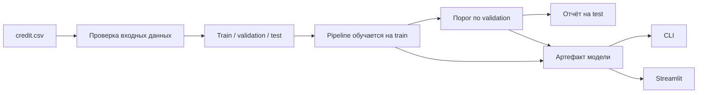

# Credit-risk — воспроизводимый ML-проект

Учебный проект на Python: подготовка табличных данных, классификация редкого события, оценка модели и приложение Streamlit. Демонстрирует путь **CSV → единый Pipeline → отчёт → CLI / веб-форма** и SQL-анализ данных.

**Граница задачи:** в `credit.csv` нет наблюдаемых дефолтов. Положительная метка создаётся известным правилом: сумма > 8 000, срок > 24 месяцев и текущий счёт `little`. Модель приближает эту искусственную метку. Её score не является подтверждённой вероятностью дефолта; приложение показывает учебный результат.

## Что можно оценить в проекте

- Единый контракт входных данных для обучения, ноутбука, CLI и Streamlit.
- `ColumnTransformer` и `Pipeline`: масштабирование чисел, обработка пропусков, One-Hot Encoding и Logistic Regression.
- Отдельные train / validation / test; выбор порога по validation и сравнение с baseline.
- Сохранение всей цепочки преобразований вместе с моделью и метаданными.
- Точная линейная декомпозиция ответа после преобразования признаков.
- SQL с агрегациями, подзапросом, CTE и оконными функциями.
- Автотесты на разделение выборок, совпадение обучения и инференса, сериализацию, CLI и веб-форму.

## Результаты проверенного запуска

1 000 строк, **13 положительных меток**. Разбиение stratified, seed=42:

| Выборка | Строк | Положительных |
| --- | ---: | ---: |
| Train | 600 | 8 |
| Validation | 200 | 2 |
| Test | 200 | 3 |

Порог **0.55** выбран по максимальному F1 на validation из сетки 0.05–0.95; test при выборе не используется.

| Модель / ориентир на test | ROC-AUC | Average precision | Precision | Recall | F1 | Accuracy |
| --- | ---: | ---: | ---: | ---: | ---: | ---: |
| Logistic Regression | 0.9949 | 0.8333 | 0.5000 | 0.6667 | 0.5714 | 0.9850 |
| Majority baseline: всегда класс 0 | 0.5000 | 0.0150 | 0 | 0 | 0 | 0.9850 |
| Точное правило создания метки | 1 | 1 | 1 | 1 | 1 | 1 |

**Вывод:** accuracy 98.5% сама по себе мало говорит о редком классе. Логистическая регрессия находит 2 из 3 положительных примеров, допускает 2 ложных срабатывания и пропускает 1. Точное правило идеально совпадает с меткой по определению — для его исполнения ML не требуется.

Из-за малого количества положительных примеров метрики и выбранный порог нестабильны. Это демонстрационный эксперимент; числа не подтверждают качество реального кредитного скоринга.

Полный отчёт: [metrics.json](reports/metrics.json), [предсказания test](reports/test_predictions.csv), [окружение запуска](reports/environment.txt). Проверено на Python 3.12.14, scikit-learn 1.7.2. Новые результаты получены другой реализацией и разбиением, чем сохранённый исторический ноутбук.

## Запуск с чистого клона

Рекомендуется **Python 3.12**. Модель обучается локально; скачивание внешнего датасета или запуск ноутбука для приложения не нужны.

```bash
git clone https://github.com/golovanov-andrei/Credit-risk.git
cd Credit-risk
python -m venv .venv
```

Активируйте окружение:

```powershell
# Windows PowerShell
.\.venv\Scripts\Activate.ps1
```

```bash
# macOS / Linux
source .venv/bin/activate
```

Установите зависимости и пакет:

```bash
python -m pip install -r requirements-dev.txt
python -m pip install --no-deps --no-build-isolation -e .
```

Обучение, предсказание для примера и приложение:

```bash
python -m credit_risk.cli train --data credit.csv --output artifacts
python -m credit_risk.cli predict --input examples/applicant.json
python -m streamlit run app.py --server.address 127.0.0.1
```

Откройте [localhost:8501](http://localhost:8501). В форме доступны все восемь признаков модели, включая пропуски сведений о счетах. Поля результата: учебный score, класс по выбранному порогу и метка точного правила. Категории A/B/C оставлены как демонстрационные интервалы score, без решений об одобрении кредита.

Модель, отчёт и предсказания сохраняются в `artifacts/`; этот каталог исключён из Git. Загружайте только доверенные локально обученные joblib-файлы. Для другого окружения переобучите модель.

## Проверки

```bash
python -m pytest
python -m pip check
```

Локально пройдено **29 тестов**. Они проверяют критичные границы правила, некорректный ввод, обучение преобразований только на train, выбор порога по validation, сохранение предсказаний после сериализации и работу настоящей формы Streamlit. [GitHub Actions](.github/workflows/ci.yml) запускает тесты, обучение и CLI на Python 3.12.

Основные зависимости зафиксированы в [requirements.txt](requirements.txt) и [requirements-dev.txt](requirements-dev.txt). Версии транзитивных зависимостей проверенного запуска приведены в [environment.txt](reports/environment.txt).

## Устройство проекта



| Путь | Назначение |
| --- | --- |
| [src/credit_risk/data.py](src/credit_risk/data.py) | Контракт данных, проверка значений и искусственная метка |
| [src/credit_risk/model.py](src/credit_risk/model.py) | Pipeline, эксперимент, артефакт, предсказание и объяснение |
| [src/credit_risk/cli.py](src/credit_risk/cli.py) | Команды train и predict |
| [app.py](app.py) | Streamlit-интерфейс |
| [notebooks/01_analysis.ipynb](notebooks/01_analysis.ipynb) | Выполненный ноутбук: EDA, SQL, эксперимент и объяснение |
| [examples/applicant.json](examples/applicant.json) | Пример JSON-входа |
| [tests/](tests/) | Автоматические проверки |
| [docs/DATA_AND_MODEL_CARD.md](docs/DATA_AND_MODEL_CARD.md) | Данные, методика и ограничения |
| [docs/INTERVIEW.md](docs/INTERVIEW.md) | Порядок демонстрации и темы для собеседования |
| [docs/REVIEW.md](docs/REVIEW.md) | Найденные проблемы и внесённые исправления |

Для повторного запуска ноутбука выберите Python из `.venv` в Jupyter-совместимом редакторе. Он использует установленный пакет; команд установки внутри ячеек, туннелей и записи `app.py` нет.

## Ограничения и дальнейшие шаги

- Метка детерминирована по входным признакам. Для исследования реального риска нужен отдельный набор с наблюдаемым исходом.
- Источник, денежные единицы и лицензия исходного CSV пока не подтверждены; известна его версия внутри репозитория.
- Пропуск сведений о счёте обрабатывается как неизвестное значение, а не как доказанное отсутствие счёта.
- `Sex` исключён из модели; это само по себе не доказывает справедливость остальных признаков.
- Score модели с `class_weight="balanced"` не калиброван. Вклады в log-odds описывают вычисление модели, а не причинность.
- Приложение предназначено для локальной демонстрации. Для эксплуатации нужны отдельные требования к данным, качеству, доступу и мониторингу.

Следующий этап: подтвердить происхождение данных, поставить задачу с наблюдаемой целью и проверить устойчивость оценки на более крупной независимой выборке.

Исходный [Credit risk.ipynb](Credit%20risk.ipynb) и [screens/](screens/) сохранены как история раннего прототипа. Их старые метрики и интерфейс отличаются от поддерживаемой версии выше.

Автор: [Андрей Голованов](https://github.com/golovanov-andrei).
